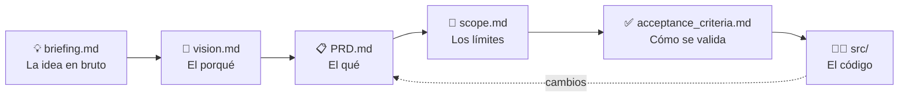

# 🍳 SDD Sample Project — Blog de Cocina

> **Primero la receta, luego la cocina.** 👨‍🍳
> Un pequeño blog de recetas usado como excusa para aprender y practicar **Spec-Driven Development (SDD)**.


---

## 📑 Índice
- [🎯 ¿De qué va esto?](#-de-qué-va-esto)
- [🧠 ¿Qué es Spec-Driven Development?](#-qué-es-spec-driven-development)
- [🔄 El flujo SDD en este proyecto](#-el-flujo-sdd-en-este-proyecto)
- [📚 Documentación](#-documentación)
- [🏷️ Cómo leer los identificadores](#️-cómo-leer-los-identificadores)
- [🥘 El producto: Blog de Cocina](#-el-producto-blog-de-cocina)
- [🔌 API REST](#-api-rest)
- [🛠️ Stack tecnológico](#️-stack-tecnológico)
- [📁 Estructura del repositorio](#-estructura-del-repositorio)
- [🚀 Puesta en marcha](#-puesta-en-marcha)
- [🗺️ Hoja de ruta](#️-hoja-de-ruta)
- [🤝 Contribuir](#-contribuir)
- [👤 Autor](#-autor)

---

## 🎯 ¿De qué va esto?
Este repositorio **no** pretende ser el próximo gran portal de recetas. 😄
Su objetivo principal es **probar Spec-Driven Development** de principio a fin con un proyecto pequeño y fácil de entender: un blog de cocina donde cualquiera puede **publicar recetas** y **leer** las de otros.

Lo interesante aquí no es solo el código, sino **el camino**:
- 📝 Cómo una idea en bruto se convierte en especificaciones claras.
- 🔗 Cómo cada requisito se conecta con sus criterios de aceptación y sus pruebas.
- 🧑‍💻 Cómo el código se escribe **a partir** de la especificación, y no al revés.

## 🧠 ¿Qué es Spec-Driven Development?
**Spec-Driven Development (SDD)** es una forma de trabajar en la que la **especificación es la fuente de verdad**:

- 📐 **Primero se especifica:** qué se construye, para quién, por qué y cómo se sabrá que está bien hecho.
- 🧱 **Después se implementa:** el código sigue lo que dice la especificación.
- ✅ **Se valida contra la spec:** cada funcionalidad se da por terminada solo cuando cumple sus criterios de aceptación.
- 🔁 **Los cambios empiezan en la spec:** si algo cambia, primero se actualiza la documentación y luego el código.

En resumen: **menos "ya lo arreglaremos luego"** y **más "sabemos exactamente qué estamos construyendo"**. 🎯

## 🔄 El flujo SDD en este proyecto



1. 💡 **Briefing:** se vuelca la idea sin filtros: problema, usuarios, ideas y dudas.
2. 🔭 **Visión:** se define el porqué a largo plazo y los principios que guían las decisiones.
3. 📋 **PRD:** se detalla qué hace el producto: historias de usuario, requisitos y modelo de datos.
4. 📏 **Alcance:** se marca qué entra en la v1, qué se aplaza y qué queda fuera.
5. ✅ **Criterios de aceptación:** se escribe cómo se comprobará que todo funciona.
6. 🧑‍💻 **Código:** se implementa hito a hito, validando contra los criterios.

## 📚 Documentación
- 💡 **[briefing.md](briefing.md)** — Contexto en bruto
  - Problema, usuarios objetivo, objetivos, ideas sin priorizar, referencias y dudas abiertas.
- 🔭 **[spec/vision.md](spec/vision.md)** — El porqué a largo plazo
  - Declaración de visión, propuesta de valor, principios de diseño y hoja de ruta.
- 📋 **[PRD.md](PRD.md)** — Qué hace el producto
  - Personas, historias de usuario, requisitos funcionales y no funcionales, flujos, modelo de datos, riesgos y métricas.
- 📏 **[spec/scope.md](spec/scope.md)** — Los límites
  - Qué entra en la v1, qué queda fuera, qué se aplaza, stack cerrado, hitos y reglas de cambio.
- ✅ **[spec/acceptance_criteria.md](spec/acceptance_criteria.md)** — Cómo se valida
  - Criterios por funcionalidad, escenarios Dado/Cuando/Entonces, casos límite, criterios medibles, definición de hecho y pruebas.

## 🏷️ Cómo leer los identificadores
Los documentos usan códigos cortos para enlazarse entre sí y mantener la **trazabilidad**:

- 🎯 **OBJ** — Objetivo (briefing)
- 👥 **HU** — Historia de usuario (PRD)
- ⚙️ **RF** — Requisito funcional: *qué hace* el sistema (PRD)
- 🛡️ **RNF** — Requisito no funcional: *cómo de bien* lo hace (PRD)
- ✅ **CA** — Criterio de aceptación (acceptance_criteria)
- 🎬 **ESC** — Escenario Dado / Cuando / Entonces
- 🧨 **CL** — Caso límite o de error
- 📊 **CNF** — Criterio no funcional medible
- 🧪 **PA** — Prueba de aceptación

**Ejemplo de trazabilidad** 🔍
`OBJ-2` ➡️ `HU-04` ➡️ `RF-05` ➡️ `CA-13` / `CA-14` ➡️ `ESC-03` ➡️ `PA-03`
*"Ver todas las recetas"* se sigue desde el objetivo hasta la prueba que lo demuestra.

## 🥘 El producto: Blog de Cocina
Un blog **minimalista** donde la receta es la protagonista. Sin anuncios, sin registro, sin ruido. 🤫

**✅ Lo que hace (v1)**
- ✍️ Publicar una receta con título, autor, ingredientes y pasos.
- 📜 Ver todas las recetas, de la más reciente a la más antigua.
- 🔎 Abrir cada receta con sus ingredientes en lista y sus pasos numerados.
- 🧹 Moderar recetas desde el panel de administración de Django.

**🚫 Lo que no hace (a propósito)**
- ❤️ Me gusta
- 💬 Comentarios
- 👤 Cuentas de usuario
- 🔍 Búsqueda y categorías

> 🧂 Principio estrella: **"Simple antes que completo"**.

## 🔌 API REST
Además de la web, el blog ofrece una API JSON (RF-14) bajo `/api/recetas/`:

| Método | Ruta | Quién | Qué hace |
|---|---|---|---|
| `GET` | `/api/recetas/` | Cualquiera | Lista las recetas publicadas, de la más reciente a la más antigua |
| `GET` | `/api/recetas/{id}/` | Cualquiera | Devuelve una receta publicada (los borradores dan 404) |
| `POST` | `/api/recetas/` | Administrador con token | Crea una receta **siempre como borrador** |

**1. Obtener el token** (una vez, con el servidor parado o en otra terminal, desde `src/`):
```bash
python manage.py migrate
python manage.py drf_create_token TU_USUARIO_ADMIN
```
Imprime el token. Se puede regenerar o borrar desde `/admin/` → *Tokens*.

**2. Probarla con `curl`:**
```bash
# Listar las recetas publicadas
curl http://127.0.0.1:8000/api/recetas/

# Ver una receta
curl http://127.0.0.1:8000/api/recetas/1/

# Crear un borrador (requiere token)
curl -X POST http://127.0.0.1:8000/api/recetas/   -H "Authorization: Token TU_TOKEN"   -H "Content-Type: application/json"   -d '{"titulo": "Tortilla de patatas", "autor": "Ana", "ingredientes": "Huevos
Patatas", "pasos": "Freír
Cuajar"}'
```
En Windows PowerShell usa `curl.exe` en lugar de `curl`, y comillas dobles escapadas dentro del JSON.

**Respuesta** (`201 Created`):
```json
{"id": 10, "titulo": "Tortilla de patatas", "autor": "Ana", "descripcion": "",
 "ingredientes": "Huevos
Patatas", "pasos": "Freír
Cuajar", "estado": "borrador"}
```

**Códigos de error:** `400` datos inválidos (un mensaje por campo), `401` falta el token o es incorrecto, `403` el usuario no es administrador, `404` receta inexistente o borrador.

> 📝 La receta creada por la API es un borrador: no sale en la portada hasta que el administrador la publique desde la web (`/recetas/borradores/`). La API no admite foto.

## 🛠️ Stack tecnológico
- 🐍 **Python 3.12+**
- 🎸 **Django 5.2 LTS** — vistas genéricas, `ModelForm` y plantillas renderizadas en el servidor
- 🗄️ **SQLite** — una base de datos en un solo archivo
- 🎨 **CSS propio** — sin frameworks, ligero y minimalista
- 🖼️ **Pillow** — para las fotos de las recetas (v1.1)
- 🔌 **Django REST Framework** — para la API opcional (RF-14)

## 📁 Estructura del repositorio
```
sdd-sample-project/
├── 📄 README.md                 ← estás aquí 👋
├── 💡 briefing.md               ← la idea en bruto
├── 📋 PRD.md                    ← qué hace el producto
├── 📂 spec/
│   ├── 🔭 vision.md             ← el porqué
│   ├── 📏 scope.md              ← los límites
│   └── ✅ acceptance_criteria.md ← cómo se valida
└── 📂 src/                      ← el código (app `recetas`, API en `api.py`)
```

## 🚀 Puesta en marcha
> 🚧 **El código aún está en el horno.** Ahora mismo el proyecto está en la fase de especificación. Estos son los pasos previstos cuando `src/` esté listo:

```bash
# 1. Clonar el repositorio
git clone https://github.com/Ssamuelfernandez/sdd-sample-project.git
cd sdd-sample-project/src

# 2. Crear y activar el entorno virtual
python -m venv venv
venv\Scripts\activate          # Windows
source venv/bin/activate       # macOS / Linux

# 3. Instalar dependencias
pip install -r requirements.txt

# 4. Preparar la base de datos
python manage.py migrate

# 5. Crear el usuario administrador (para moderar)
python manage.py createsuperuser

# 6. ¡A cocinar! 🍳
python manage.py runserver
```

Después, abre 👉 `http://127.0.0.1:8000/`

**🧪 Ejecutar las pruebas**
```bash
python manage.py test
```


## 👤 Autor
**Samuel Fernández** — [@Ssamuelfernandez](https://github.com/Ssamuelfernandez)

---

<p align="center">Hecho con 🧡, mucha especificación y algo de hambre 🍝</p>
